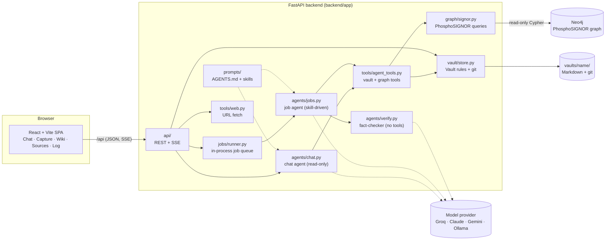
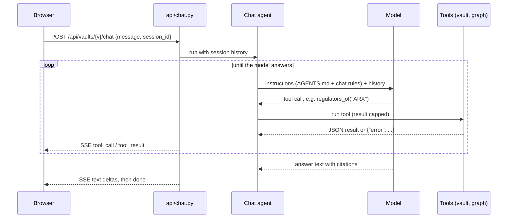
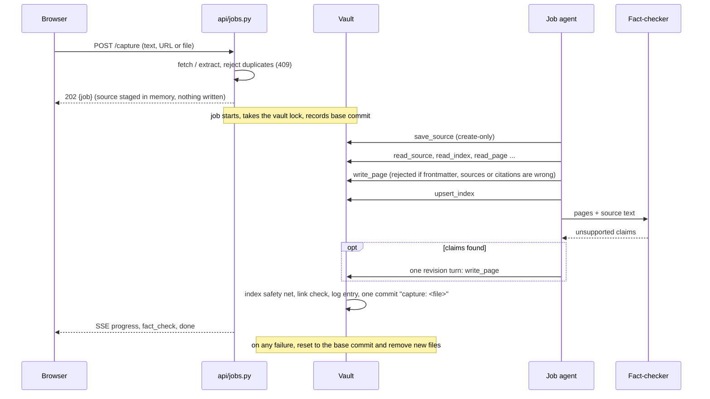

# PhosphoChat

A website for an LLM-Wiki "second brain" (Karpathy's method) over the PhosphoSIGNOR
kinase–substrate graph:

- **Capture**: paste text, a URL or a file. It is saved unchanged in `sources/`, then an agent
  folds it into `wiki/` pages.
- **Chat**: answers from the wiki and the Neo4j graph, citing `[[pages]]`, `[[source: …]]` and
  `(SIGNOR-…; PMID …)`. A good answer can be saved back into the wiki.
- **Wiki and Sources**: a browser with wiki links, callouts and backlinks.
- **Log**: every session that changed the vault, with buttons for Sync, Lint and Digest.

The SIGNOR graph tools from the old `mcp/` server run inside the backend, not as a separate MCP
process. The agents get only narrow tools: no shell, no code and no Cypher, so they can't wander
off and write scripts.

## Run with Docker

The image holds the backend and the built UI. `docker compose` adds Neo4j and a one-time loader
that fills the graph from the bundled `seed/PhosphoSIGNOR_all_Data.tsv`.

```bash
cp .env.example .env    # set at least: a model key, NEO4J_PASSWORD, ADMIN_USERNAME, ADMIN_PASSWORD
docker compose up -d --build
# open http://localhost:8000 and sign in as the admin
```

The first start takes about a minute, while Neo4j starts and the graph loads. After that, the
loader sees a filled graph and skips. Vaults, users and the graph live in Docker volumes
(`vaults`, `appdb`, `neo4j-data`) and survive `down`/`up` and rebuilds.

**Configuring a deployment.** Nothing site-specific is baked into the image; it reads everything
when the container starts.

| Variable | Required | Purpose |
|---|---|---|
| `NEO4J_PASSWORD` | yes | Password for the bundled Neo4j, 8+ characters; compose refuses to start without it |
| `ADMIN_USERNAME`, `ADMIN_PASSWORD` | first start | First admin account; without them nobody can sign in |
| `GROQ_API_KEY` / `ANTHROPIC_API_KEY` / `GOOGLE_API_KEY` / `OXION_API_KEY` / `OPENAI_API_KEY` | the one your models use | Model provider keys |
| `MODEL`, `CHAT_MODEL`, `JOB_MODEL`, `VERIFY_MODEL` | no | Which models to use (see Models) |
| `APP_PORT` | no (8000) | Host port for the web UI |
| `COOKIE_SECURE` | no (false) | Set `true` once the site is behind https |
| `VERIFY_CAPTURES`, `SESSION_DAYS`, `TOOL_OUTPUT_CHARS`, … | no | Behaviour; see Configuration below |

Ways to supply these:
- **An `.env` file** next to `docker-compose.yml`.
- **Shell or platform environment variables.**
- **Secret files:** any variable can be given as `<NAME>_FILE=/run/secrets/<file>`, which is read
  when `<NAME>` itself is unset. This works with Docker/compose secrets and Kubernetes, and keeps
  the value out of `docker inspect`. `docker-compose.yml` has a commented example; put the files
  in `secrets/`, which is gitignored and never sent to the build.

Inside the stack, `NEO4J_URI`, `VAULTS_DIR` and `DATA_DIR` are fixed by compose, so the
localhost values in a development `.env` don't matter. On start the app logs its configuration
(`docker compose logs app`): the models per role, whether each needed key is set (never the
values), the Neo4j connection and whether an admin exists.

| Task | Command |
|---|---|
| Logs | `docker compose logs -f app` |
| Update | `git pull && docker compose up -d --build` |
| Back up vaults / users | `docker run --rm -v phosphochat_vaults:/v -v "$PWD":/b alpine tar czf /b/vaults.tgz -C /v .` (same with `phosphochat_appdb`) |
| Reload the graph | `docker compose run --rm graph-loader python scripts/load_signor.py --file /app/seed/PhosphoSIGNOR_all_Data.tsv --wipe` |
| Use the Ollama desktop app on the host | `MODEL=ollama:<model>`; nothing else (see Models → Local models) |
| Run Ollama inside the stack | `docker compose --profile local-llm up -d`, then `OLLAMA_BASE_URL=http://ollama:11434/v1` |

Neo4j's ports aren't published, so the stack doesn't clash with another Neo4j on the host.
Uncomment `ports:` under `neo4j` to open the Neo4j browser.

## Run for development

Prerequisites: Python 3.12+, Node 20+, Docker, and a Groq API key (https://console.groq.com).

```bash
# 1. Config
cp .env.example .env           # set GROQ_API_KEY, NEO4J_PASSWORD, ADMIN_USERNAME/ADMIN_PASSWORD

# 2. Neo4j with PhosphoSIGNOR. Uncomment the neo4j `ports:` in docker-compose.yml first,
#    or keep using an existing Neo4j on localhost:7687.
docker compose up -d neo4j
backend/.venv/Scripts/python backend/scripts/load_signor.py --if-empty   # loads seed/ by default

# 3. Backend
cd backend
python -m venv .venv
.venv/Scripts/pip install -e ".[dev]"
.venv/Scripts/python -m uvicorn app.main:app --reload --port 8000

# 4. Frontend (second terminal)
cd frontend
npm install
npm run dev                    # http://localhost:5173 (proxies /api to :8000)
```

On first start the backend creates an **empty** vault in `vaults/default/` from the template
and gives it its own git repo. `npm run build` puts the UI in `frontend/dist`, which the backend
then serves itself at http://localhost:8000.

## Users and roles

Everyone has to sign in. There are two roles:

| | user | admin |
|---|---|---|
| Chat with the wiki and graph | ✓ | ✓ |
| Read every vault: Wiki, Sources, Log entries | ✓ | ✓ |
| Capture, Save to wiki, Sync, Lint, Digest, Retry, job progress | | ✓ |
| Create vaults | | ✓ |
| Manage users (Users page: add, change role, reset password, disable, delete) | | ✓ |

- **First admin:** set `ADMIN_USERNAME` and `ADMIN_PASSWORD` in `.env` and start the backend.
  If no active admin exists, that account is created; if it exists, it is promoted and its
  password reset. That also lets you recover from a lost admin password. After that, admins add
  everyone else on the **Users** page. There is no public sign-up.
- **Sessions:** an HttpOnly, `SameSite=Lax` cookie lasts `SESSION_DAYS`. Set `COOKIE_SECURE=true`
  behind https.
- **Storage:** users and sessions are in `DATA_DIR/phosphochat.db`, which is gitignored. Passwords
  are hashed with scrypt, and only a hash of each session token is stored.
- **Server enforcement:** the server checks every API call. The UI only hides what a role can't
  use. Requests from other sites are refused, and five failed logins lock that username for five
  minutes.
- **Guards:** the last active admin can't be demoted, disabled or deleted, and admins can't disable
  or delete themselves.
- **Effects take hold at once:** disabling a user or resetting their password signs them out
  everywhere.
- **Chat:** history is per user, and only admins may pick a different model per chat request.

## Models

A model is written `<provider>:<model-id>` in `MODEL` (or per role, below). Switching provider is
a config change, and roles can use different providers at the same time.

| Provider | Example | Needs |
|---|---|---|
| Groq | `groq:openai/gpt-oss-120b` | `GROQ_API_KEY` |
| Claude | `anthropic:claude-sonnet-5-5` (alias `claude:`) | `ANTHROPIC_API_KEY` (Console key, not a Pro login) |
| Gemini, Google AI Studio | `google:gemini-2.5-flash` (aliases `gemini:`, `google-gla:`) | `GOOGLE_API_KEY` |
| Gemini, Vertex AI | `google-cloud:gemini-2.5-flash` | `GOOGLE_CLOUD_PROJECT`, `GOOGLE_CLOUD_LOCATION`, Google credentials |
| OpenAI | `openai:gpt-5.2` (Responses API), `openai-chat:gpt-5.2` (Chat Completions) | `OPENAI_API_KEY`; `OPENAI_BASE_URL` only for an OpenAI proxy |
| OpenRouter | `openrouter:anthropic/claude-sonnet-5-5` | `OPENROUTER_API_KEY` |
| **Ollama** (local) | `ollama:qwen3:14b` | Nothing: defaults to `http://localhost:11434/v1`; `OLLAMA_BASE_URL` to change |
| **LM Studio** (local) | `lmstudio:<model-id>` | Nothing: defaults to `http://localhost:1234/v1`; `LMSTUDIO_BASE_URL` to change |
| vLLM / llama.cpp server | `vllm:<model-id>` | `VLLM_BASE_URL` (default `http://localhost:8000/v1`) |
| Any OpenAI-compatible server (Jan, LocalAI, a company gateway…) | `compat:<name>:<model-id>`, e.g. `compat:local:llama3.1:8b` | `COMPAT_<NAME>_BASE_URL`, optional `COMPAT_<NAME>_API_KEY`. Define as many names as you like. |
| Oxion AI | `oxion:<model-id>` | `OXION_API_KEY` (starts with `cc_`) |
| Other providers pydantic-ai knows (`mistral:`, `deepseek:`, …) | as pydantic-ai | Their usual key variable |

Every key can also come from a `<NAME>_FILE` secret file. At startup the log shows each role's
provider and whether it's configured. Admins see the same in the sidebar: the dot turns red when
a key is missing, and hovering shows the reason.

**Local models.** The agents call tools and read long instructions, so small models struggle:

- **Model choice:** use Qwen3 14B or larger, or Llama 3.1 8B or larger. Models of 4B and below
  tend to skip tools or write poor pages.
- **Context:** give Ollama a long context with `OLLAMA_CONTEXT_LENGTH=32768`. The default is too
  short for the instructions plus tool results.

Where Ollama runs decides the setup:

| PhosphoChat runs | Ollama runs | Setup |
|---|---|---|
| On your machine (`uvicorn`) | Ollama desktop app | Nothing; `localhost:11434` is the default |
| In Docker | Ollama desktop app on the host | Nothing; inside Docker the default becomes `host.docker.internal:11434`. If chat says it can't reach Ollama, set the environment variable `OLLAMA_HOST=0.0.0.0` for the Ollama app and restart it. On Windows: System Properties → Environment Variables; on macOS: `launchctl setenv OLLAMA_HOST 0.0.0.0`. |
| In Docker | Bundled container | `docker compose --profile local-llm up -d`, then `docker compose exec ollama ollama pull qwen3:14b`, and set `OLLAMA_BASE_URL=http://ollama:11434/v1` |

LM Studio works the same way on port 1234. Turn on its local server and set
`LMSTUDIO_BASE_URL` if you changed the port.

Groq's free tier has tight tokens-per-minute limits. Every tool result is capped at
`TOOL_OUTPUT_CHARS`, and a rate-limit error shows up as a readable message in the UI.

**One model per role (optional).** Each role can use its own model; unset roles use `MODEL`.

| Role | Setting | What it does | Suggested |
|---|---|---|---|
| Chat | `CHAT_MODEL` | Answers questions | Fast or cheap; answers can simply be asked again |
| Wiki jobs | `JOB_MODEL` | Capture, sync, lint, digest | The strongest model; its output is saved in the wiki |
| Fact-check | `VERIFY_MODEL` (falls back to `JOB_MODEL`) | Checks new pages against the source | A *different* model from the writer, so it doesn't repeat the writer's mistakes |

On Groq, rate limits apply per model, so splitting roles also gives each one its own token
budget. The sidebar shows the chat and job models; hover over them to see all three.

## Architecture

### Components



The backend is one Python process. Agents call the graph and the vault through plain function
tools, so there is no MCP server, no subprocess and no shell between the model and the data.

### Modules

| Module | Responsibility |
|---|---|
| [`api/`](backend/app/api/) | HTTP surface. `vaults.py` (list/create vaults, config, health), `wiki.py` (read pages, sources, index, log, git history), `jobs.py` (capture, sync/lint/digest, job status and SSE progress), `chat.py` (streaming chat over SSE). |
| [`jobs/runner.py`](backend/app/jobs/runner.py) | Runs each job as an asyncio task and keeps its event log so the UI can follow or replay progress. Jobs on the same vault wait for each other through the vault's lock. |
| [`agents/chat.py`](backend/app/agents/chat.py) | Chat agent: read-only vault tools, graph tools and `load_skill`. Keeps per-session history in memory, trimmed at whole turns. |
| [`agents/jobs.py`](backend/app/agents/jobs.py) | Job pipeline for capture, sync, lint and digest: deterministic pre-step, agent run with the skill as instructions, fact-check and one revision (capture/sync), deterministic post-step. |
| [`agents/verify.py`](backend/app/agents/verify.py) | Fact-checker: gets the source text and the new pages in its prompt and returns the claims the source doesn't support. It has no tools. |
| [`agents/runtime.py`](backend/app/agents/runtime.py) | Runs an agent and turns pydantic-ai stream events into small UI events (`text`, `tool_call`, `tool_result`, `usage`); turns provider errors into readable messages. |
| [`prompts/`](backend/app/prompts/) | `AGENTS.md` (the LLM-Wiki schema and grounding rules) and `skills/{capture,sync,lint,digest,query}/SKILL.md`. One copy for every vault; read on each run. |
| [`tools/agent_tools.py`](backend/app/tools/agent_tools.py) | The only tools agents get. Read: `read_index`, `list_pages`, `read_page`, `search_pages`, `list_sources`, `read_source`, `read_log`. Write (jobs only): `write_page`, `upsert_index`. Chat only: `load_skill`. Plus the 8 graph tools. Every result is capped at `TOOL_OUTPUT_CHARS`. |
| [`tools/web.py`](backend/app/tools/web.py) | Fetches a URL for capture (http/https only, private addresses refused, 5 MB cap) and extracts readable Markdown with trafilatura. Called by the API, not by agents. |
| [`graph/signor.py`](backend/app/graph/signor.py) | Port of the old `signor-graph` MCP server: `search_entities`, `get_entity`, `regulators_of`, `targets_of`, `sites_of`, `find_paths`, `get_evidence`, `graph_overview`. Read-only sessions. |
| [`vault/store.py`](backend/app/vault/store.py) | `Vault`: safe paths, create-only sources, page validation (frontmatter, known sources, citations), index and log editing, mechanical lint, git commit and rollback. `VaultRegistry` creates vaults from `vault/template/`. |
| [`llm.py`](backend/app/llm.py), [`config.py`](backend/app/config.py) | Model selection from `MODEL` (Groq gets a client that waits out rate limits); settings from `.env`, re-read whenever the file changes. |
| [`frontend/src/`](frontend/src/) | React SPA. `api.ts` is the API client (including the SSE readers); `components/Markdown.tsx` renders `[[links]]`, `[[source: …]]`, callouts and SIGNOR/PMID links; `pages/` holds one component per tab. |

### Vault layout

A vault holds content only. It is a plain folder that Obsidian can open:

```
vaults/<name>/
├── .git/        one commit per job (plus "source: …" when a capture saves its source)
├── index.md     every wiki page with a one-line description (## Pages, ## Recaps)
├── log.md       one entry per job, newest first, under "# Log"
├── sources/     raw inputs, immutable: <date>-<slug>.md notes (+ original .pdf/.tsv/... files)
└── wiki/        agent-written pages with frontmatter: title, summary, sources, last_updated
```

The schema and skills are app-wide, in `backend/app/prompts/`. Editing a skill there changes
every vault, and takes effect on the next job without a restart.

### Chat: one question



Lookups that find nothing ("no page X", "no protein named Y, did you mean…") come back as
ordinary tool results. A model that keeps guessing therefore can't use up its retries and abort
the chat. "Save to wiki" turns an answer into a note source and runs a capture job on it.

### Capture: one source into the wiki



**A capture is all or nothing.** The source is written only inside the job, and every write job
ends in exactly one commit. If any step fails, the vault goes back to the commit it had when the
job started: the new source note, any original file, new pages, and index and log edits are all
removed. That covers a provider error, the writer finishing without writing a page, or the
fact-check itself failing. The staged source stays in memory, so **Retry**
(`POST /api/jobs/{id}/retry`) can run the capture again until the server restarts.

Sync works the same way over every source not yet named in `log.md` (up to 10 per run).
For lint, code first runs the mechanical checks (broken links, orphans, index drift, schema,
uncited blocks) and fixes the index. The agent then does the checks that need reading and writes
`wiki/lint-report.md`. For digest, code collects the period's log entries and the agent writes
`wiki/<year>-w<week>-recap.md`.

### Design rules

**The code does the bookkeeping and the model does the editorial work.** A weak model can't
break the bookkeeping, because the code handles it:

| Done in code | Done by the agent (tools) |
|---|---|
| Save sources unchanged with frontmatter (create-only, dedup by URL and content hash) | Read sources, the index, pages and the graph |
| Find unprocessed sources (sync); add frontmatter to files dropped into `sources/` | Write whole wiki pages (`write_page` rejects missing frontmatter, unknown sources and uncited paragraphs) |
| Mechanical lint (broken links, orphans, index drift, schema, uncited blocks) and its index auto-fixes | Semantic lint (stale pages, contradictions, duplicates), `lint-report` |
| Prepend the `log.md` entry under `# Log`, index any page left unindexed, check links | `upsert_index` with descriptions; the recap for digest |
| Fact-check new pages against the source (verifier agent) and send unsupported claims back once | Revise the flagged claims |
| git commit per job; roll back wiki/index/log if the job fails | |

**Grounding.** The wiki records what the sources say, not what the model knows. This is enforced
three ways:
1. The schema forbids background knowledge.
2. `write_page` rejects any paragraph, list item or table row without a `[[source: …]]` or SIGNOR
   citation.
3. Optionally, after capture and sync, a verifier agent with no tools compares each claim with
   the source text. The writer gets one turn to fix whatever it flags.

The fact-check is off by default because it costs roughly 1.5–2× the tokens of a capture. Turn it on for one capture with the switch on the Capture screen, or for every capture and sync with `VERIFY_CAPTURES=true`.

**Safety.** Captured text is untrusted. The prompts treat sources as data, URL fetches refuse
private and loopback addresses, and agents have no tool that runs code. Agents can write only
whole pages under `wiki/` and lines in `index.md`. Sources are create-only, and path checks keep
every read and write inside the vault.

**Configuration.** Everything comes from the repo-root `.env`. It is re-read when the file
changes and wins over the process environment for the keys it defines.

| Setting | Default | Purpose |
|---|---|---|
| `MODEL` | see `.env.example` | pydantic-ai model string (see Models above) |
| `CHAT_MODEL`, `JOB_MODEL`, `VERIFY_MODEL` | empty | Per-role models; empty uses `MODEL` (`VERIFY_MODEL` uses `JOB_MODEL`) |
| `NEO4J_URI`, `NEO4J_USERNAME`, `NEO4J_PASSWORD`, `NEO4J_DATABASE` | `bolt://localhost:7687`, `neo4j`, –, `neo4j` | Graph connection |
| `VAULTS_DIR`, `DEFAULT_VAULT` | `vaults`, `default` | Where vaults live; the vault created on first start |
| `ADMIN_USERNAME`, `ADMIN_PASSWORD` | –, – | Bootstrap admin, created at startup when no active admin exists |
| `DATA_DIR`, `SESSION_DAYS`, `COOKIE_SECURE` | `data`, `14`, `false` | User database location; session length; https-only cookie |
| `TOOL_OUTPUT_CHARS` | `8000` | Cap on any single tool result sent to the model |
| `VERIFY_CAPTURES`, `VERIFY_SOURCE_CHARS` | `false`, `12000` | Fact-check after capture/sync; source text given to the checker |
| `CHAT_REQUEST_LIMIT`, `JOB_REQUEST_LIMIT` | `15`, `40` | Max model calls per chat answer / per job |
| `CHAT_HISTORY_MESSAGES` | `20` | Chat history kept per session |

## Tests

```bash
cd backend && .venv/Scripts/python -m pytest -q
```

- `test_graph.py`: the old MCP smoke test, ported. It needs Neo4j and is skipped otherwise.
- `test_vault.py`: the vault rules (paths, immutability, frontmatter, log, index, lint, git).
- `test_jobs.py`: capture, lint and sync with a scripted model, so no API key is needed. Covers
  tool-call correction, rollback, output caps and the fact-check/revision loop.
- `test_api.py`: endpoints that start jobs, capture retry validation, new-vault layout.
- `test_config.py`: `.env` edits are picked up without a restart and beat stale environment copies.
- `test_auth.py`:
  - login, logout, throttling and password changes;
  - the last-admin and self guards;
  - a role matrix: anonymous, user and admin against every route;
  - per-user chat history and the cross-site check.

## Prototype limits

- Login sessions and users are in SQLite on one server. Serve over https (`COOKIE_SECURE=true`)
  before exposing it beyond localhost.
- Jobs and chat history live in memory and are lost on restart; the vault itself is on disk and in git.
- `search_pages` is a plain substring search. Add SQLite FTS or embeddings once the wiki grows.
- Not built yet: graph view, scheduled digest, model picker in the UI, and an MCP facade over `app/graph/signor.py`.
