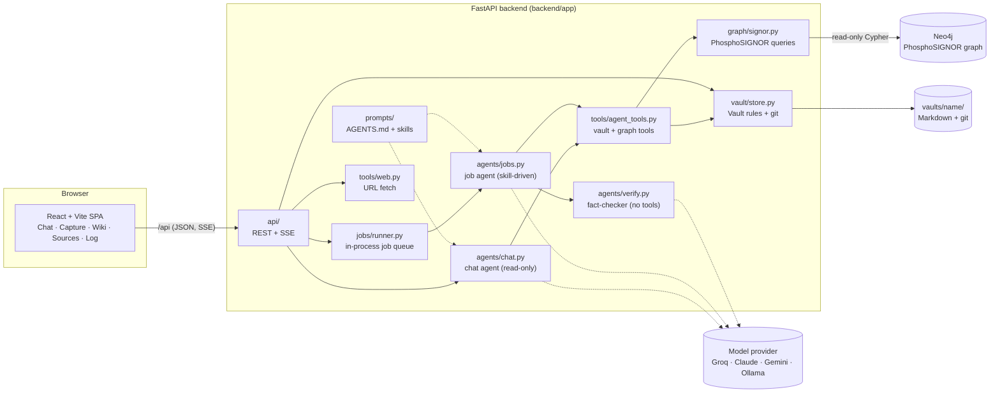
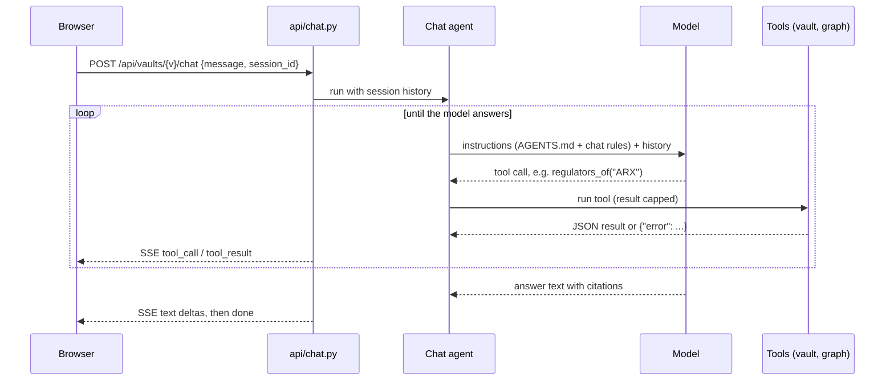
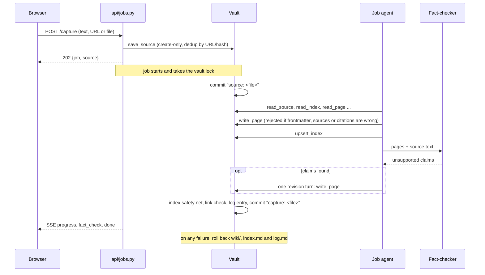

# PhosphoChat

A website for an LLM-Wiki "second brain" (Karpathy's method) over the PhosphoSIGNOR
kinase–substrate graph:

- **Capture**: paste text, a URL or a file. It is saved unchanged in `sources/`, then an agent
  folds it into `wiki/` pages.
- **Chat**: answers from the wiki and the Neo4j graph, citing `[[pages]]`, `[[source: …]]` and
  `(SIGNOR-…; PMID …)`. A good answer can be saved back into the wiki.
- **Wiki and Sources**: a browser with wiki links, callouts and backlinks.
- **Log**: every session that changed the vault, with buttons for Sync, Lint and Digest.

The SIGNOR graph tools from the old `mcp/` server run inside the backend, not as a separate MCP
process. The agents get only narrow tools: no shell, no code and no Cypher, so they can't wander
off and write scripts.

## Run it

Prerequisites: Python 3.12+, Node 20+, Docker, and a Groq API key (https://console.groq.com).

```bash
# 1. Config
cp .env.example .env           # set GROQ_API_KEY (and NEO4J_PASSWORD if not testpassword)

# 2. Neo4j with PhosphoSIGNOR (skip if the old signor-neo4j-test container is running)
docker compose up -d
backend/.venv/Scripts/python backend/scripts/load_signor.py --file "../mcp/data/PhosphoSIGNOR_all_Data.tsv" --wipe

# 3. Backend
cd backend
python -m venv .venv
.venv/Scripts/pip install -e ".[dev]"
.venv/Scripts/python -m uvicorn app.main:app --reload --port 8000

# 4. Frontend (second terminal)
cd frontend
npm install
npm run dev                    # http://localhost:5173 (proxies /api to :8000)
```

On first start the backend creates an **empty** vault in `vaults/default/` from the template
and gives it its own git repo. `npm run build` puts the UI in `frontend/dist`, which the backend
then serves itself at http://localhost:8000.

## Models

`MODEL` in `.env` is a pydantic-ai model string. Each provider reads its own key, so
switching provider is a config change:

| Provider | `MODEL` | Key |
|---|---|---|
| Groq (default) | `groq:openai/gpt-oss-120b`, `groq:openai/gpt-oss-20b`, `groq:qwen/qwen3.8-27b` | `GROQ_API_KEY` |
| Claude | `anthropic:claude-sonnet-5-5` | `ANTHROPIC_API_KEY` (Console key, not a Pro login) |
| Google AI Studio | `google-gla:gemini-2.5-flash` | `GOOGLE_API_KEY` |
| OpenAI-compatible / Ollama | `openai:qwen3:14b` | `OPENAI_API_KEY=ollama`, `OPENAI_BASE_URL=http://localhost:11434/v1` |

Groq's free tier has tight tokens-per-minute limits. Every tool result is capped at
`TOOL_OUTPUT_CHARS`, and a rate-limit error shows up as a readable message in the UI.

## Architecture

### Components



The backend is one Python process. Agents call the graph and the vault through plain function
tools, so there is no MCP server, no subprocess and no shell between the model and the data.

### Modules

| Module | Responsibility |
|---|---|
| [`api/`](backend/app/api/) | HTTP surface. `vaults.py` (list/create vaults, config, health), `wiki.py` (read pages, sources, index, log, git history), `jobs.py` (capture, sync/lint/digest, job status and SSE progress), `chat.py` (streaming chat over SSE). |
| [`jobs/runner.py`](backend/app/jobs/runner.py) | Runs each job as an asyncio task and keeps its event log so the UI can follow or replay progress. Jobs on the same vault wait for each other through the vault's lock. |
| [`agents/chat.py`](backend/app/agents/chat.py) | Chat agent: read-only vault tools, graph tools and `load_skill`. Keeps per-session history in memory, trimmed at whole turns. |
| [`agents/jobs.py`](backend/app/agents/jobs.py) | Job pipeline for capture, sync, lint and digest: deterministic pre-step, agent run with the skill as instructions, fact-check and one revision (capture/sync), deterministic post-step. |
| [`agents/verify.py`](backend/app/agents/verify.py) | Fact-checker: gets the source text and the new pages in its prompt and returns the claims the source doesn't support. It has no tools. |
| [`agents/runtime.py`](backend/app/agents/runtime.py) | Runs an agent and turns pydantic-ai stream events into small UI events (`text`, `tool_call`, `tool_result`, `usage`); turns provider errors into readable messages. |
| [`prompts/`](backend/app/prompts/) | `AGENTS.md` (the LLM-Wiki schema and grounding rules) and `skills/{capture,sync,lint,digest,query}/SKILL.md`. One copy for every vault; read on each run. |
| [`tools/agent_tools.py`](backend/app/tools/agent_tools.py) | The only tools agents get. Read: `read_index`, `list_pages`, `read_page`, `search_pages`, `list_sources`, `read_source`, `read_log`. Write (jobs only): `write_page`, `upsert_index`. Chat only: `load_skill`. Plus the 8 graph tools. Every result is capped at `TOOL_OUTPUT_CHARS`. |
| [`tools/web.py`](backend/app/tools/web.py) | Fetches a URL for capture (http/https only, private addresses refused, 5 MB cap) and extracts readable Markdown with trafilatura. Called by the API, not by agents. |
| [`graph/signor.py`](backend/app/graph/signor.py) | Port of the old `signor-graph` MCP server: `search_entities`, `get_entity`, `regulators_of`, `targets_of`, `sites_of`, `find_paths`, `get_evidence`, `graph_overview`. Read-only sessions. |
| [`vault/store.py`](backend/app/vault/store.py) | `Vault`: safe paths, create-only sources, page validation (frontmatter, known sources, citations), index and log editing, mechanical lint, git commit and rollback. `VaultRegistry` creates vaults from `vault/template/`. |
| [`llm.py`](backend/app/llm.py), [`config.py`](backend/app/config.py) | Model selection from `MODEL` (Groq gets a client that waits out rate limits); settings from `.env`, re-read whenever the file changes. |
| [`frontend/src/`](frontend/src/) | React SPA. `api.ts` is the API client (including the SSE readers); `components/Markdown.tsx` renders `[[links]]`, `[[source: …]]`, callouts and SIGNOR/PMID links; `pages/` holds one component per tab. |

### Vault layout

A vault holds content only. It is a plain folder that Obsidian can open:

```
vaults/<name>/
├── .git/        one commit per job (plus "source: …" when a capture saves its source)
├── index.md     every wiki page with a one-line description (## Pages, ## Recaps)
├── log.md       one entry per job, newest first, under "# Log"
├── sources/     raw inputs, immutable: <date>-<slug>.md notes (+ original .pdf/.tsv/... files)
└── wiki/        agent-written pages with frontmatter: title, summary, sources, last_updated
```

The schema and skills are app-wide, in `backend/app/prompts/`. Editing a skill there changes
every vault, and takes effect on the next job without a restart.

### Chat: one question



Lookups that find nothing ("no page X", "no protein named Y, did you mean…") come back as
ordinary tool results. A model that keeps guessing therefore can't use up its retries and abort
the chat. "Save to wiki" turns an answer into a note source and runs a capture job on it.

### Capture: one source into the wiki



Sync works the same way over every source not yet named in `log.md` (up to 10 per run).
For lint, code first runs the mechanical checks (broken links, orphans, index drift, schema,
uncited blocks) and fixes the index. The agent then does the checks that need reading and writes
`wiki/lint-report.md`. For digest, code collects the period's log entries and the agent writes
`wiki/<year>-w<week>-recap.md`.

### Design rules

**The code does the bookkeeping and the model does the editorial work.** A weak model can't
break the bookkeeping, because the code handles it:

| Done in code | Done by the agent (tools) |
|---|---|
| Save sources unchanged with frontmatter (create-only, dedup by URL and content hash) | Read sources, the index, pages and the graph |
| Find unprocessed sources (sync); add frontmatter to files dropped into `sources/` | Write whole wiki pages (`write_page` rejects missing frontmatter, unknown sources and uncited paragraphs) |
| Mechanical lint (broken links, orphans, index drift, schema, uncited blocks) and its index auto-fixes | Semantic lint (stale pages, contradictions, duplicates), `lint-report` |
| Prepend the `log.md` entry under `# Log`, index any page left unindexed, check links | `upsert_index` with descriptions; the recap for digest |
| Fact-check new pages against the source (verifier agent) and send unsupported claims back once | Revise the flagged claims |
| git commit per job; roll back wiki/index/log if the job fails | |

**Grounding.** The wiki records what the sources say, not what the model knows. This is enforced
three ways:
1. The schema forbids background knowledge.
2. `write_page` rejects any paragraph, list item or table row without a `[[source: …]]` or SIGNOR
   citation.
3. After capture and sync, a verifier agent with no tools compares each claim with the source
   text. The writer gets one turn to fix whatever it flags.

The fact-check costs roughly 1.5–2× the tokens of a capture. Turn it off with `VERIFY_CAPTURES=false`.

**Safety.** Captured text is untrusted. The prompts treat sources as data, URL fetches refuse
private and loopback addresses, and agents have no tool that runs code. Agents can write only
whole pages under `wiki/` and lines in `index.md`. Sources are create-only, and path checks keep
every read and write inside the vault.

**Configuration.** Everything comes from the repo-root `.env`. It is re-read when the file
changes and wins over the process environment for the keys it defines.

| Setting | Default | Purpose |
|---|---|---|
| `MODEL` | see `.env.example` | pydantic-ai model string (see Models above) |
| `NEO4J_URI`, `NEO4J_USERNAME`, `NEO4J_PASSWORD`, `NEO4J_DATABASE` | `bolt://localhost:7687`, `neo4j`, –, `neo4j` | Graph connection |
| `VAULTS_DIR`, `DEFAULT_VAULT` | `vaults`, `default` | Where vaults live; the vault created on first start |
| `TOOL_OUTPUT_CHARS` | `8000` | Cap on any single tool result sent to the model |
| `VERIFY_CAPTURES`, `VERIFY_SOURCE_CHARS` | `true`, `12000` | Fact-check after capture/sync; source text given to the checker |
| `CHAT_REQUEST_LIMIT`, `JOB_REQUEST_LIMIT` | `15`, `40` | Max model calls per chat answer / per job |
| `CHAT_HISTORY_MESSAGES` | `20` | Chat history kept per session |

## Tests

```bash
cd backend && .venv/Scripts/python -m pytest -q
```

- `test_graph.py`: the old MCP smoke test, ported. It needs Neo4j and is skipped otherwise.
- `test_vault.py`: the vault rules (paths, immutability, frontmatter, log, index, lint, git).
- `test_jobs.py`: capture, lint and sync with a scripted model, so no API key is needed. Covers
  tool-call correction, rollback, output caps and the fact-check/revision loop.
- `test_api.py`: endpoints that start jobs, capture retry validation, new-vault layout.
- `test_config.py`: `.env` edits are picked up without a restart and beat stale environment copies.

## Prototype limits

- Single user, no auth. Bind to localhost.
- Jobs and chat history live in memory and are lost on restart; the vault itself is on disk and in git.
- `search_pages` is a plain substring search. Add SQLite FTS or embeddings once the wiki grows.
- Not built yet: graph view, scheduled digest, model picker in the UI, and an MCP facade over `app/graph/signor.py`.
